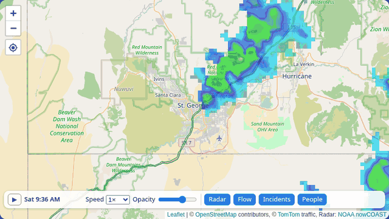
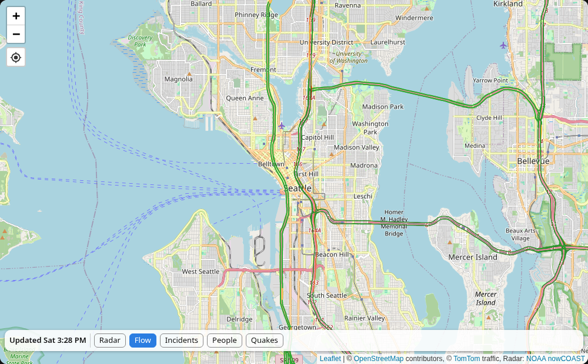
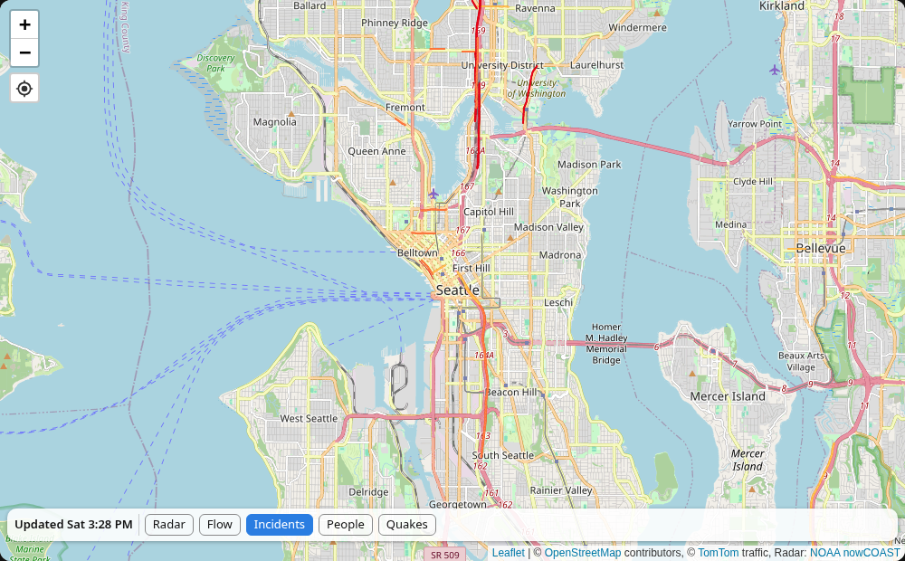
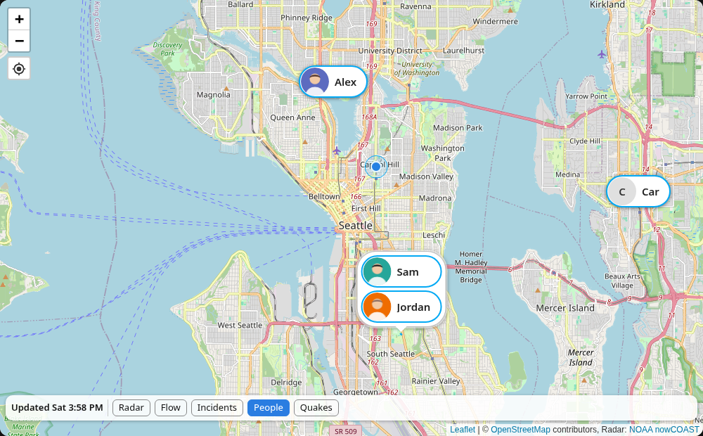
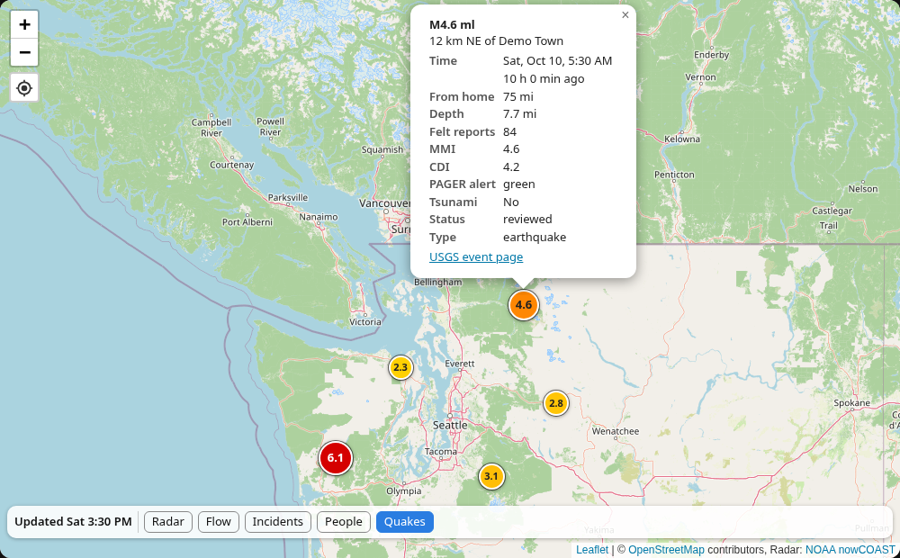
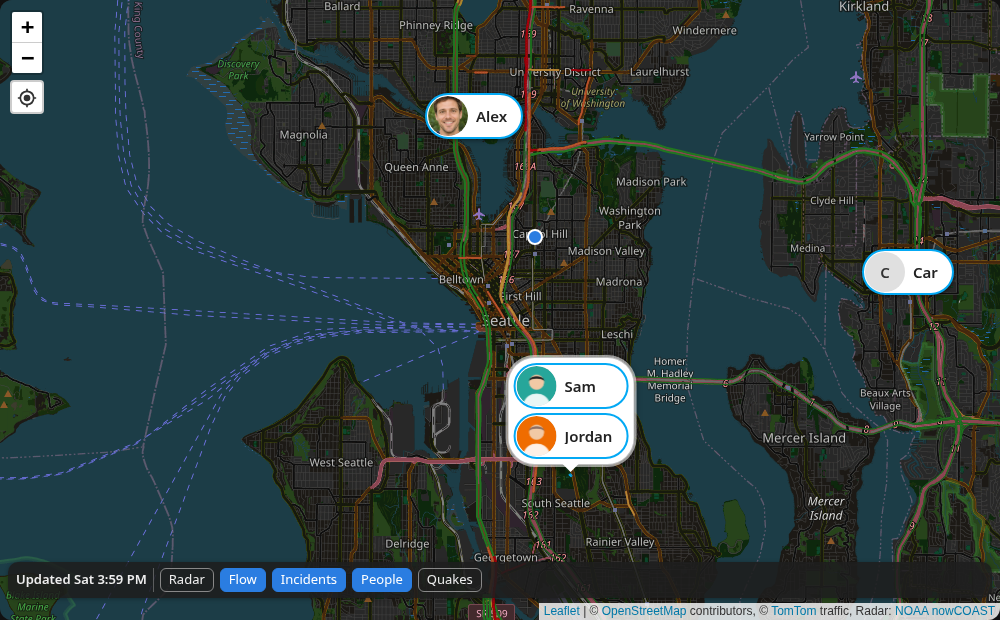

# Map Overlay Card

A Home Assistant dashboard card that puts traffic, weather radar, people and earthquakes on one map.



## What it does

- Animated weather radar with play/pause, speed and opacity (NOAA nowCOAST, Iowa Mesonet NEXRAD or RainViewer; no API key needed)
- Live traffic flow and incidents from TomTom (free API key required)
- People and device trackers as name pills with their name and picture (you can override both)
- Earthquakes from the last 24 hours (USGS), colored by magnitude, with full details on tap
- Your zones, a home marker, light or dark map
- Buttons on the map to turn each layer on and off
- Set up entirely in the visual card editor

## Install

[](https://my.home-assistant.io/redirect/hacs_repository/?owner=codemonkey2k5&repository=map-overlay-card&category=plugin)

1. Make sure [HACS](https://hacs.xyz/docs/use/) is installed.
2. Click **Open in HACS** above. Home Assistant opens and asks to add the repository. Click **Add**, then **Download**.
3. When HACS asks to reload, click **Reload**. In the phone app, close and reopen the app.

This card is not in the HACS default list yet, so it's added as a custom repository. The button above does that for you. To do it by hand: HACS > three-dot menu > **Custom repositories**, paste `https://github.com/codemonkey2k5/map-overlay-card`, pick type **Dashboard**, click **Add**.

### Add it to a dashboard

1. Open a dashboard and click the **pencil** (Edit dashboard).
2. Click **+ Add card** and search for **Map Overlay Card**.
3. Paste your TomTom key (see below) and click **Save**.

The map centers on your Home Assistant home location. To center it somewhere else, move the pin in **Map center**.

### Free TomTom key (for traffic)

1. Sign up at <https://developer.tomtom.com/> (free, no credit card).
2. In the TomTom dashboard, open **Keys** and copy "My first API key".
3. Paste it into **TomTom API key** in the card editor.

The free tier covers 50,000 traffic tile requests a day. The key is stored in your dashboard config and sent from the browser when tiles load, so anyone who can open your dashboard can see it. Blank it before sharing screenshots or YAML. Without a key the card still shows the map, radar, people and earthquakes.

## Usage

### Radar
Press play to loop the last few hours. The label shows the time of each frame. Speed and opacity sit next to it. With radar off, the label shows when the map was last updated.

### Traffic flow


### Traffic incidents


### People and zones
Each person shows as a pill with their picture (or initials) and name. People close together share one bubble that points at their location; zoom in to split them. Tap a person to open their details. Zones are drawn as circles.



By default every person with GPS is shown, plus any GPS device tracker that doesn't belong to a person. A phone that belongs to a person is shown as that person, not twice.

### Earthquakes
Dots show the magnitude, from yellow (small) to red (6+). Tap one for place, magnitude, time and how long ago, distance from home, depth, felt reports, MMI/CDI, PAGER alert, tsunami flag, status and a link to the USGS page.



### Dark map


### Changing a person's name or picture
In the card editor, open **Names** to type a different name, or **Pictures** to upload one. Home Assistant's crop dialog opens, the same one used in Settings > People:

- Scroll the mouse wheel or pinch to zoom.
- Drag the image to move it.
- Drag the square, or its corners, to move or resize the crop area. It stays square.
- Click **Crop**. The picture shows as a circle on the map.

### Size
In a sections view the card starts full width and fills the screen height (**Full screen mode**; in the card's Layout tab, turn **Auto height** on). With a fixed row count it fills its grid cell instead. In masonry and panel views it uses **Map height**, or the full screen when Full screen mode is on.

## Settings

| Editor name | YAML key | Default | What it does |
|---|---|---|---|
| TomTom API key | `tomtom_key` | none | Turns on traffic |
| Map center | `location` | home | Where the map centers (`latitude`/`longitude` also work in YAML) |
| Zoom | `zoom` | 10 | Starting zoom, 1-19 |
| Map height (px) | `height` | 450 | Height outside a sized grid cell |
| Full screen mode | `full_height` | on | Map fills the screen height |
| Dark map | `dark` | off | Dark base map |
| Home marker | `show_home_marker` | on | Dot at your home zone |
| Radar | `show_radar` | on | Radar on when the map opens |
| Radar source | `radar_source` | `nowcoast` | `nowcoast` (US), `nexrad` (US), `rainviewer` (worldwide) |
| Radar history (h) | `radar_hours` | 3 | Loop length; max nowCOAST 8, NEXRAD 24, RainViewer 2 |
| Frame step (min) | `radar_step_minutes` | 10 | Minutes between frames |
| Radar opacity | `radar_opacity` | 0.6 | 0 to 1 |
| Autoplay radar | `autoplay` | on | Start the loop by itself |
| Smooth NEXRAD | `radar_smoothing` | off | Softens blocky NEXRAD cells |
| Radar refresh (min) | `radar_refresh_minutes` | 5 | How often to look for new frames |
| Traffic flow | `show_flow` | on | Flow layer on when the map opens |
| Traffic incidents | `show_incidents` | on | Incidents layer on when the map opens |
| Traffic refresh (min) | `traffic_refresh_minutes` | 5 | How often traffic tiles reload |
| People | `show_people` | on | People layer on when the map opens |
| People to show | `entities` | everyone with GPS | Pick `person` / `device_tracker` entities |
| Show zones | `show_zones` | off | Draw your [zones](https://www.home-assistant.io/integrations/zone/) |
| Names / Pictures | `people` | none | Per-person name and picture |
| Earthquakes | `show_quakes` | on | Earthquake layer on when the map opens |
| Min magnitude | `quake_min_magnitude` | 2.5 | Smallest quake shown |
| Units | `quake_units` | `imperial` | Miles or km for radius, distance and depth |
| Radius | `quake_radius` | worldwide | Only quakes this far from home |
| Quake refresh (min) | `quake_refresh_minutes` | 5 | How often to check USGS (minimum 1) |

YAML example:

```yaml
type: custom:map-overlay-card
tomtom_key: YOUR_KEY
zoom: 9
show_zones: true
quake_min_magnitude: 3
quake_radius: 300
```

## Credits

- Map library: [Leaflet](https://leafletjs.com) (BSD-2-Clause, bundled; see [THIRD_PARTY_NOTICES.md](THIRD_PARTY_NOTICES.md))
- Base map: © [OpenStreetMap](https://www.openstreetmap.org/copyright) contributors
- Traffic: [TomTom Traffic API](https://developer.tomtom.com/traffic-api/documentation)
- Radar: [NOAA nowCOAST](https://nowcoast.noaa.gov/), [Iowa Environmental Mesonet](https://mesonet.agron.iastate.edu/) (NEXRAD), [RainViewer](https://www.rainviewer.com/api.html)
- Earthquakes: [USGS Earthquake Hazards Program](https://earthquake.usgs.gov/earthquakes/feed/v1.0/geojson.php)

License: MIT
